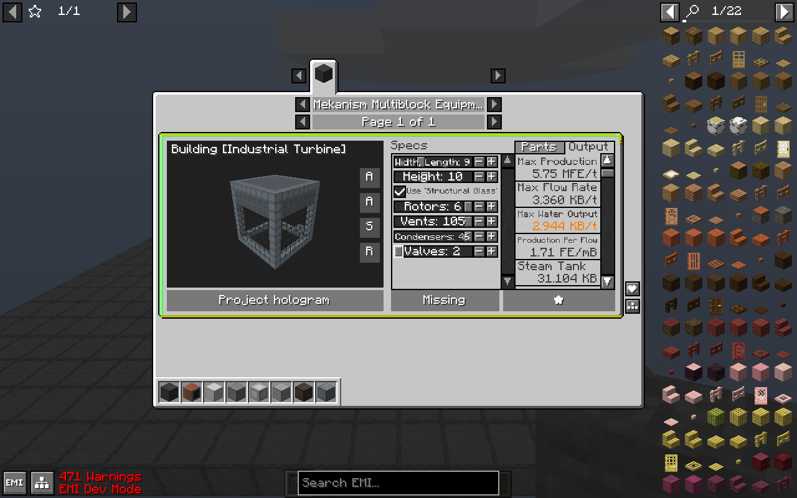
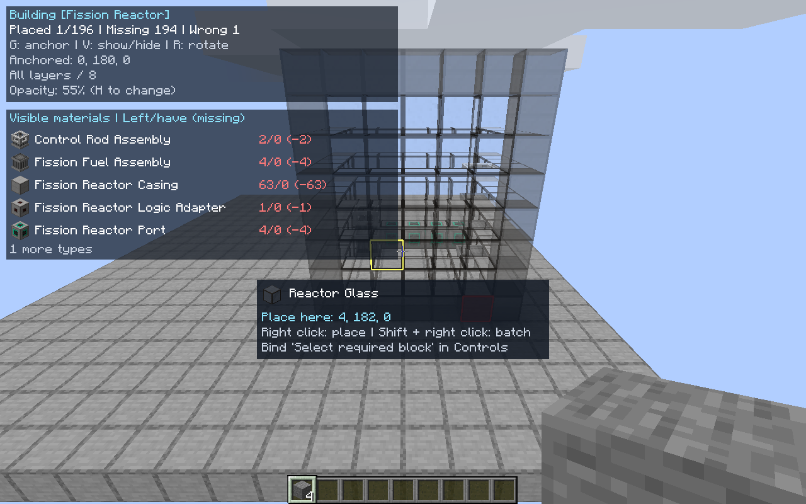

# MekaPlan

Plan Mekanism multiblocks in EMI. Edit a live 3D preview, check performance and materials, then project the design into your world.

Minecraft **1.20.1 · Forge**. An unofficial companion to **Just Enough Mekanism Multiblocks (JEMM)**, built with LDLib.

[日本語](README.ja.md) · [Downloads](https://github.com/syarukasu/mekanism-multiblock-architect/releases) · [Issues](https://github.com/syarukasu/mekanism-multiblock-architect/issues)





## Preview, plan, build

- One equipment category with a rotatable, zoomable preview beside JEMM's settings and performance.
- Live dimensions, internal components, materials and performance. Single-layer, up-to-layer and shell visibility controls.
- Textured world holograms. Correct blocks disappear; incorrect blocks or supported orientation mismatches turn red.
- Inventory-aware shortages for the whole design or visible layers, with installed blocks subtracted for a matching fixed projection.
- Saved designs, including configuration, recipe, rotation and layer settings.
- Optional block selection, exact-item/NBT refill, material HUD and completion notification/hiding.
- Inventory-backed single-block and batch placement when the server also has MekaPlan.
- Optional Nova recipe search and EMI recipe links, production rates, upgrades, coils and parallel processors. Optional More Thermal Evaporation and Mekanism Extras integration.

The base equipment covers the dynamic tank, thermal evaporation plant, induction matrix, thermoelectric boiler, SPS, fission reactor, fusion reactor and industrial turbine. Generator structures require Mekanism: Generators.

## Install

Add the release JAR to the client's mods directory with these dependencies:

| Dependency | Tested version |
|---|---|
| Forge | 47.4.18 |
| Mekanism | 10.4.16.80 |
| LDLib | 1.0.50 |
| EMI | 1.1.24 |
| Just Enough Mekanism Multiblocks | **4.27** (4.18 is unsupported) |
| TooManyRecipeViewers (provides the JEI API) | 0.9.0+mc.20.1 |

Real JEI 15.20.0.132 is an alternative to TMRV. **Do not install JEI and TMRV together.**

Optional integrations tested: Mekanism: Generators 10.4.16.80, Nova Mekanism 1.2.2, More Thermal Evaporation 3.1.0 and Mekanism Extras 1.5.0. None of these addons is required by MekaPlan. More Thermal Evaporation Compat support is provisional: its 2.3-fix1 upstream dependency issue prevented runtime verification.

Preview and holograms need no server installation. For inventory-backed placement, install the **same MekaPlan version on both sides**. MekaPlan's dedicated-server dependency is Forge only; the server still needs the mods that provide the blocks. Alpha.8 uses placement protocol 2 and is not placement-compatible with alpha.7.

The previous name was “Mekanism: Structure Preview”. The internal mod ID remains `mekpreview`; remove older copies before updating.

## Controls

Open the equipment page with **K**, edit the settings beside the model, then choose hologram projection. Drag to rotate the model; scroll to zoom. Search, materials and favorites panels keep the preview visible.

| Default key | Hologram control |
|---|---|
| G | Fix position / follow aim |
| V | Show / hide |
| R | Rotate 90 degrees |
| H | Cycle opacity |
| Arrow keys | Move horizontally |
| Page Up / Page Down | Move vertically |
| [ / ] | Change layer |
| Backslash | All / single / up-to-layer |

Assign **Select required target block** in Controls; it starts unbound. Selection uses the hotbar and main inventory and leaves tagged materials alone. Refill uses only an exact item-and-NBT match.

With MekaPlan on the server, right-click a projected block to place it, or Shift-right-click to place visible blocks in batches. Survival consumes materials. Existing solid blocks and block entities are not overwritten; Forge placement events and permissions are checked. Placement is limited to 32 blocks from the player, 16 blocks per tick and 8192 per request.

Client options: `config/mekpreview-client.toml`. Favorites: `config/mekpreview/favorites.json` (128 designs, previous-file backup).

The material HUD grows to the available screen height. If the list still overflows, hold **Alt** and scroll the mouse wheel to reach every item. Long item names wrap; quantities are right-aligned. Ordinary scrolling keeps its normal hotbar behavior.

## Scope

JEMM and supported addons supply structure data and performance calculations. Rates are calculated estimates, not running-machine measurements. Nova's fixed structures are not resizable. Optional integrations are version-specific, not a universal addon parser.

Completion checks physical blocks and supported facing/axis properties, not machine formation, settings, upgrades, external pipes or actual output. Upgrades and non-block components need manual installation. Unloaded positions are not complete. Inventory integration excludes offhand, backpacks and storage networks. No .litematic compatibility. Shader compatibility is unverified.

## Build and test

Install a Java 17 JDK. The Gradle wrapper downloads pinned upstream dependencies from Modrinth Maven and Curse Maven; dependency JARs are not bundled.

```sh
./gradlew build projectZip
./gradlew runGameTestServer -PserverOnly
```

On Windows use gradlew.bat. There are 62 unit tests and 13 dedicated-server placement tests; the latter run without client-only dependencies at runtime. `runClient -PvisualSmoke -PhudSmoke` checks material HUD overflow and resizing in the development client.

`runClient -PvisualSmoke` launches an isolated development client and creates a QA world under run/. It does not change a Prism instance or an external server. `-Pjei` selects real JEI. `-PlocalDeps` uses SHA-256-checked copies prepared by `prepare-deps.ps1 -ModsPath <directory>` (add `-IncludeJei` for JEI). Offline builds still need cached Forge/Gradle artifacts.

Optional addon runs use `-Paddons -Pextras` and local deps artifacts named in build.gradle. They are not required for a normal build. The 24 legacy formation-fixture tests are separate from JEMM integration verification.

## Credits and license

MIT. See [LICENSE](LICENSE) and [THIRD_PARTY.md](THIRD_PARTY.md).

MekaPlan is not an official Mekanism, JEMM, LDLib, EMI or TMRV project. In-game models and textures come from installed mods; their code and assets are not redistributed in the release JAR.
